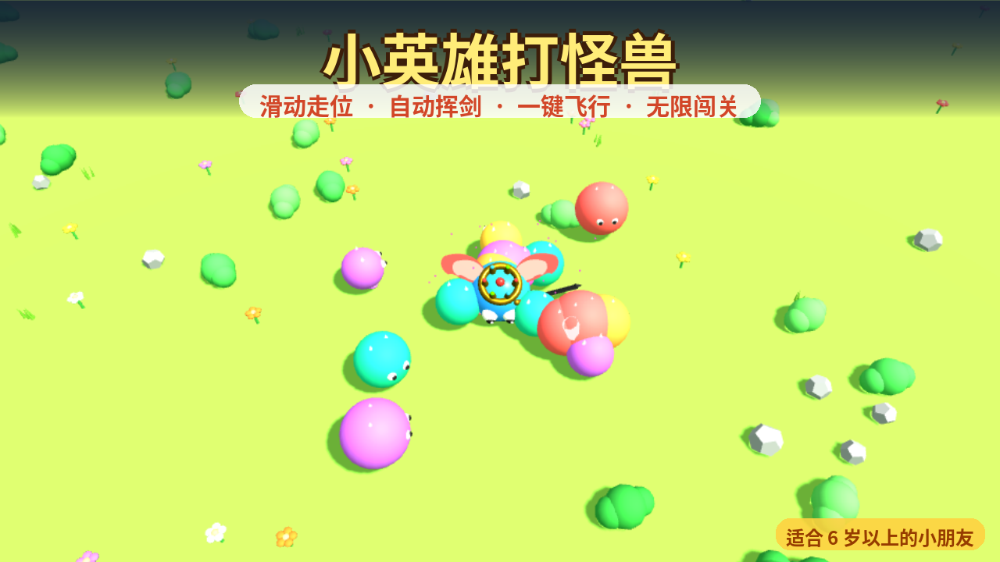

# 👑 小英雄打怪兽

- **类型**：动作 / 儿童向
- **适合年龄**：6 岁及以上
- **玩法简介**：一款 3D 无限打怪小游戏，专门为小朋友设计。主角是一个头戴金王冠、手拿大宝剑、长着一对红色翅膀的球形小英雄，在无边森林里跑动，靠近怪兽就会自动挥剑攻击。怪兽源源不断出现、越打越多，每打 5 只升一级，永远不会结束。打开网页即可直接开玩，无需点开始。
- **运行方式**：用浏览器直接打开 `index.html` 即可（需联网加载 Three.js 3D 引擎，首次触摸屏幕或按键后自动播放音乐）。

## 🎮 操作说明

| 操作 | 效果 |
| --- | --- |
| 单指滑动 / 鼠标拖动 | 手指往哪个方向滑，小英雄就往哪个方向走 |
| 方向键 / WASD（电脑） | 控制移动方向 |
| ✈️「飞」按钮（屏幕底部） | 点一下起飞、再点一下降落；飞行中照样能滑动走位 |
| 空格键（电脑） | 切换飞行 |

## ✨ 游戏特色

- 🧚 小英雄造型：金王冠 + 大宝剑 + 会扇动的红翅膀，还有大眼睛和红脸蛋
- 🌲 无尽森林：树木、花草随跑动循环复用，可以一直跑下去
- 👾 无限刷怪：每 0.5 秒冒出一只怪兽，上限随升级不断提高，永远打不完
- ⚔️ 自动攻击：靠近怪兽自动挥剑，带前冲、身体前倾和月牙斩击光弧
- 🔊 欢快音乐：儿歌风循环旋律 + 打击/欢呼音效，均由 Web Audio API 实时合成
